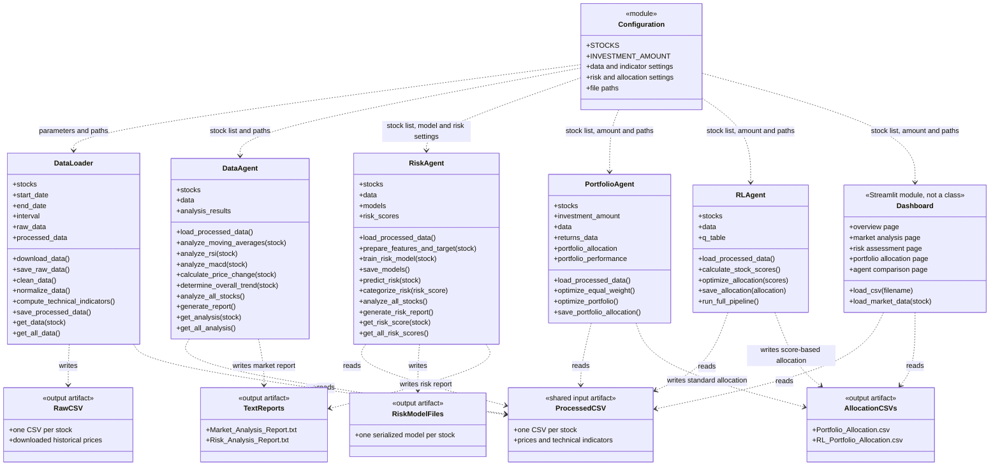

# Multi-Agent Portfolio Optimizer: Class Diagram

## Class and Module Structure

## Runtime Design

- `DataLoader` is the data-preparation stage. It downloads historical prices, cleans and normalizes the data, computes indicators, and persists per-stock CSV files.
- The four agents are independent consumers of the processed CSV files. There is no shared agent base class, service layer, or central orchestrator; each agent loads the files itself and can be run as a script.
- `DataAgent` calculates technical-analysis signals and can write a market report. `RiskAgent` trains a random-forest regressor per stock, predicts risk, and writes serialized models and a risk report. `PortfolioAgent` creates an equal-weight allocation. `RLAgent` uses calculated stock scores to create a proportional allocation.
- `Dashboard` is a top-level Streamlit script with helper functions and page branches, not an object-oriented view/controller. It reads processed and exported CSV files directly.
- `Configuration` is a module of constants rather than an instantiated configuration object. Components import the settings and paths they need.

## Important Implementation Notes

- `PortfolioAgent` is defined twice in `agents/portfolio_agent.py`. The later class binding replaces the earlier one; the two definitions are currently duplicates. The diagram treats them as one effective class.
- Despite its docstring and configuration values, `PortfolioAgent.optimize_portfolio()` currently performs equal weighting. `MIN_ALLOCATION`, `MAX_ALLOCATION`, `RISK_FREE_RATE`, and the portfolio performance/returns fields are not used by that implementation.
- `RLAgent` is described as Q-learning based, but `q_table` is not used for learning. The current flow calculates indicator-based scores and normalizes those scores into allocations.
- The dashboard's risk table uses hard-coded sample values, and its allocation controls calculate a display-only custom allocation. The page controls are not connected to the agent pipelines.
- `test.py` checks dependency imports and basic workspace setup; it does not define automated tests for these classes.
